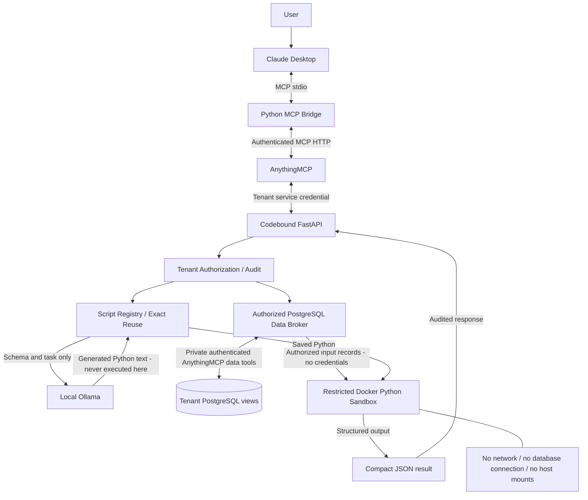

# Codebound Secure Sandbox for AnythingMCP

## Project overview

AI agents often receive large raw MCP responses when they need only a small calculated answer. Codebound lets an agent request Python processing near the data, execute it in a restricted Docker sandbox, and receive compact structured JSON.

The demonstrated path is Claude Desktop → Python MCP bridge → AnythingMCP → Codebound → authorized PostgreSQL data → Docker → compact result. Local Ollama generates Python; only the sandbox executes it.

## Key features

- Authenticated AnythingMCP integration and a Claude Desktop stdio bridge with ten tools.
- Local Ollama Python generation, script creation/modification, version counters and exact reuse.
- Restricted disposable Docker execution with authorized PostgreSQL input.
- Tenant separation, persistent script registry, execution/AI auditing and compact JSON responses.
- Sequential terminal benchmarking with captured MCP body bytes and reported Ollama token usage.

## Architecture

Diagram source: [docs/architecture.mmd](docs/architecture.mmd).



## Requirements

Windows PowerShell 5.1+, Python 3.11+ (installed backend: 3.13), Docker Desktop with Linux/WSL 2 engine and Compose 2.20.3+; native Ollama with the local `qwen2.5-coder:3b` model; Claude Desktop for the interactive demo. The existing AnythingMCP checkout, configured `.env`, PostgreSQL volume and authenticated tenant/broker configuration are required.

Backend dependencies are FastAPI/Uvicorn, plus pytest/httpx for tests (`pyproject.toml`). The bridge uses a separate environment with pinned MCP SDK 2.3.0 and Windows DPAPI dependencies in `integrations/claude_desktop/requirements*.txt`. PostgreSQL and AnythingMCP run through `docker/compose.local.yml`; Node is unnecessary for the prebuilt Compose images and Python bridge.

## Quick start

From the configured repository:

```powershell
.\launch.ps1
```

This reuses healthy services, starts missing Docker Desktop/Ollama when their executables are found, starts PostgreSQL/AnythingMCP and the managed Codebound API, waits with timeouts, checks the sandbox image/engine, local model, authenticated discovery and the existing Claude configuration/DPAPI bridge. Paths resolve relative to this checkout. It never downloads a model, rewrites credentials/configuration or closes Claude. Failed prerequisites produce an actionable error; services already started may remain running.

```powershell
.\launch.ps1 -Status       # read-only service checks and bridge validation
.\launch.ps1 -Stop         # stop managed API and Compose services; retain volumes/images/data
.\launch.ps1 -Test         # default regression suite; live suites below
.\launch.ps1 -Benchmark    # same as .\benchmark.ps1
```

Stop leaves independently managed Docker Desktop/Ollama and Claude running. It validates backend process ownership and cleans only project-labelled workers. An unmanaged server or incompatible running mode requires operator action.

For a new machine, prepare the dependencies explicitly before normal launch:

```powershell
python -m venv .venv
.\.venv\Scripts\python.exe -m pip install -e '.[dev]'
python -m venv .venv-claude
.\.venv-claude\Scripts\python.exe -m pip install -r integrations/claude_desktop/requirements-dev.txt
.\launch\setup.ps1
.\launch\build-worker.ps1
ollama pull qwen2.5-coder:3b
$env:OLLAMA_MODEL = 'qwen2.5-coder:3b'
```

The model setting may instead live in gitignored `.local/ollama.json` as `{"model":"qwen2.5-coder:3b"}`. Do not recreate environments or regenerate existing datasets during normal use. An empty checkout needs synthetic data from `python -m codebound.generate_data` using the backend environment. Provision AnythingMCP using its preserved upstream instructions, log in at port 3000, then use `launch/login-anythingmcp.ps1` and `launch/integrate.ps1 -Configure -Ollama` to register tenant tools/private PostgreSQL views. Restart only the managed backend after changing its configuration (`launch/stop.ps1 -Development`, then `launch.ps1`). Never replace an existing `.env` or volume.

Claude setup is an explicit operator operation: review `launch/configure-claude.ps1 -Preview` before running `launch/configure-claude.ps1`. It preserves other settings, backs up existing bytes and prepares a current-user DPAPI snapshot. It detects the MSIX redirected config path; `-ConfigPath` selects an explicit installation. Normal root launch only verifies this configuration.

## Demo

Open Claude Desktop. After initial configuration, save your work and quit/reopen Claude yourself so it loads the server. Enable `codebound-tenant-a`, then ask:

> Call codebound_run_task with task exactly "Calculate September 2026 ticket revenue.", reference {"kind":"connector","id":"postgres-railway-a"} and parameters {"year":2026,"month":9}. Report ticket_count, total_revenue_cents, script_id, script_reused, ollama_called and execution_mode. Do not request raw records.

Expected synthetic answer: **45 tickets, 373864 EUR cents**, execution mode `local_docker`. Repeat the exact task/reference/parameters to show `script_reused=true`, `ollama_called=false`. A saved script can also be reused on the first request. Modify with `codebound_modify_script` and an expected version, then explicitly execute it again. Source edits increment a version counter; historical source versions are not archived.

The ten tools are `codebound_list_datasets`, `codebound_list_scripts`, `codebound_create_script`, `codebound_get_script`, `codebound_update_script`, `codebound_delete_script`, `codebound_execute_script`, `codebound_generate_script`, `codebound_modify_script`, and `codebound_run_task`.

A real Claude invocation was demonstrated before this cleanup. Automated SDK smoke checks verify the bridge independently; they do not constitute a new invocation inside Claude Desktop.

## Benchmark

```powershell
.\benchmark.ps1                 # three raw samples, one first run, three reuse samples
.\benchmark.ps1 -Fresh          # unique task label forces a new signature; saved script retained
.\benchmark.ps1 -Samples 5
```

Run after launch, sequentially without other demos/tests. All workflows use tenant A, connector `postgres-railway-a`, September 2026 and the same count/revenue calculation. The baseline retrieves all authorized synthetic rows through the existing private PostgreSQL MCP tool and independently filters/calculates September totals locally. It validates completeness and compares both Codebound runs against those totals and expected assertions. No cloud inference occurs.

The raw path is a counterfactual ordinary MCP data-access workflow: it uses the trusted tenant mapping, while the public Claude bridge intentionally hides raw-data tools. Initialization, readiness checks and model warm-up are outside timed samples. The first run is labelled as generation or reuse according to response and audit evidence. Every later run must use the same script/version and avoid Ollama generation. No script or production row is deleted to force a cold run.

The table shows per-sample medians; the first run has one sample. Results, sample metrics, timestamp, versions and methodology are saved to gitignored `benchmarks/results/latest.json`, without credentials, raw rows or request headers. Failed runs save a failed status and any completed samples.

- **MCP response body bytes:** captured JSON/SSE body, including MCP framing; HTTP headers, transport overhead and bridge stdio framing excluded.
- **Tool payload / compact result bytes:** canonical UTF-8 JSON reserialization, separate from the full MCP response body. Raw dataset size is printed separately.
- **Calls:** caller MCP invocations, uniquely correlated completed Codebound requests, broker schema/data tool calls, Ollama requests/generation POSTs and successful Docker executions are separate measurements. Unobserved gateway retries and internal SQL counts are unavailable.
- **Latency:** MCP call through validated result; raw includes local calculation. Ollama generation includes readiness/validation; Docker helper time includes provisioning and cleanup.
- **Tokens:** only actual Ollama prompt/evaluation counts when reported. **Claude tokens: Not directly measurable.** No bytes-per-token heuristic is presented as usage.

Smaller agent-facing payloads do not imply fewer backend operations or lower latency. See the current terminal output/result file for measured comparisons.

## Security

Identity comes from configured tenant service credentials, never a tool argument. Scripts/datasets are authorized before generation/execution. Separate agent keys select tenant tool servers; fixed broker mappings select authorized PostgreSQL views. Schema/task context goes to local Ollama; only authorized records and parameters enter Docker, with no database credentials or network access. The loopback-only Ollama client rejects remote models, bounds requests and has no cloud fallback or automatic repair. AST screening is compatibility checking, not the execution security boundary.

The worker keeps existing enforced controls: UID/GID 10001, read-only root, no host mounts, network `none`, all capabilities dropped, no-new-privileges, builtin seccomp, private namespaces, 128 MiB RAM without extra swap, 0.5 CPU, 16 PIDs, 16 MiB noexec/nosuid/nodev scratch, five-second script deadline and bounded output. The trusted launcher checks engine support and inspects policy before starting each container; exact-name removal runs in cleanup. Limits are server settings, not agent arguments. Source is never evaluated on the Windows host. Keep the Docker socket out of workers/AnythingMCP/Ollama.

Scripts, execution audits and AI metrics persist in `data/codebound.sqlite3`; audit failures suppress results. Source, raw data and stderr are excluded from Codebound execution audit events. AnythingMCP may retain synthetic tool inputs/outputs. `.local` holds sensitive credentials, DPAPI snapshots, state/logs and local evidence; it is ignored by Git but is not a secret vault. DPAPI protects the bridge snapshot for the current Windows account/machine, not from that same user's compromise.

## Troubleshooting

```powershell
.\launch.ps1 -Status
.\launch\diagnose-claude.ps1
.\.venv-claude\Scripts\python.exe integrations/claude_desktop/smoke_test.py
.\launch\test.ps1 -Docker
.\launch\test.ps1 -Mcp
.\launch\test.ps1 -Ollama
```

Run live suites sequentially; they create/delete their own disposable fixtures. `-Ollama` requires the configured model. Backend logs are in `.local/backend.err.log`; do not publish raw logs or credentials. Missing image: run `launch/build-worker.ps1`. Missing model: `ollama list`, explicitly pull the configured local model. Generation timeouts: warm the model and close competing GPU workloads; preserve security deadlines. Authentication failures: review existing registration, key rotation and DPAPI snapshot as the same Windows user. Unmanaged port 8000 or a different sandbox mode: inspect status and stop the appropriate managed backend explicitly. Never kill an arbitrary port owner.

## Limitations

This is hackathon isolation using the shared Docker Desktop Linux kernel, not production hostile-code isolation. The trusted backend/helper has broad Docker daemon authority. There is no microVM boundary, independent security certification, durable orphan reaper, distributed quota or tamper-proof audit. A host/daemon crash can prevent cleanup. Untrusted scripts can forge their own JSON result; independent benchmark calculation checks this particular scenario only.

Authentication is a local demo tenant credential model; delegated end-user identity is incomplete. The trusted private broker key can read both tenant tools and must remain server-side. Protect OS/workspace access and use one API process because tenant capacity controls are process-local. Production deployment needs stronger identity/secrets management, redaction/retention, key rotation, a restricted launcher and stronger runtime isolation. Native Ollama's loopback API has no Codebound tenant authentication. Claude Desktop is an external AI host and sees chosen tool inputs/results; local generation does not imply that the entire Claude conversation stays local.
