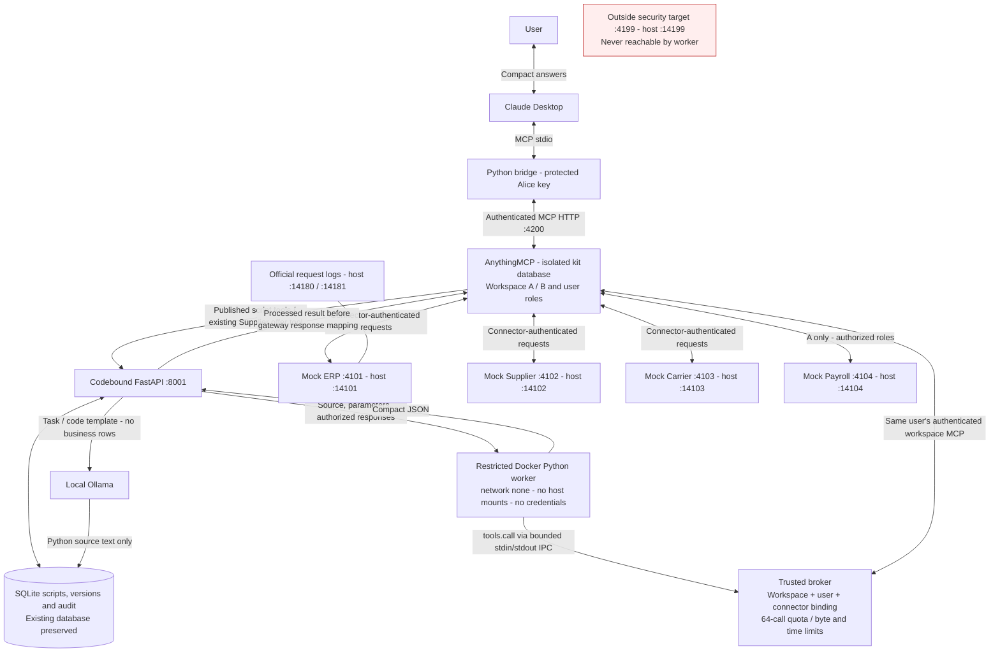

# Codebound Secure Sandbox for AnythingMCP

Codebound runs Python near business data and returns compact JSON to an AI agent. AnythingMCP handles authenticated MCP tools; local Ollama generates source; disposable Docker workers execute it. The demonstration now uses the **official Codebound hackathon kit**, rather than Railway ticket data.

## Supported functionality

- **Level 1:** a three-step Docker processor on the existing `mock_supplier_list_offers` tool: USD → EUR, 19% VAT, whitespace normalization. Broken input fails with its `price_usd` path and no partial results.
- **Level 2:** typed MCP tools `price_drift_check`, `catalogue_total`, and `stuck_orders`, with real pagination, supplier batching and mediated workspace tool calls.
- Local Ollama generation and exact saved-script reuse through `codebound_run_task`; direct authenticated APIs for script creation, retrieval, execution, deletion and generation-based modification.
- Workspace/user authorization, connector bindings, bounded calls, persistent script/audit storage and an SDK stdio bridge for Claude Desktop.
- **Level 3 is not implemented:** no credentials are injected into scripts and no worker network access is enabled. `supplier_account` is absent.

Compatibility assessment: the existing script store, Ollama client and Docker policy remain in use. The PostgreSQL-only broker was insufficient for the kit, so a trusted broker now mediates tool calls over stdin/stdout. The original Supplier tool keeps its identity and routes to an external Codebound processor endpoint; its response returns before the gateway's response mapping. This is a connector integration, not a native AnythingMCP sandbox extension. Upstream AnythingMCP and the official kit's fixture/checker files are unchanged.

## Architecture

Source: [docs/architecture.mmd](docs/architecture.mmd).



## Environment and identities

| Service | Host loopback port (official internal port) |
|---|---:|
| Isolated AnythingMCP dashboard / MCP API | 3100 / 4200 |
| Codebound kit API / Swagger | 8001 |
| Mock ERP / Supplier / Carrier / Payroll | 14101 / 14102 / 14103 / 14104 (4101?4104) |
| Official mock / outside request logs | 14180 / 14181 (4180 / 4181) |
| Outside-host security target | 14199 (4199) |
| Native Ollama | 11434 |

Workspace **A / Alpha** has ERP, Supplier, Carrier and Payroll. **Alice** is its ADMIN; **Carol** is its VIEWER with the Staff role and no Payroll permission. Workspace **B / Beta** has ERP, Supplier and Carrier; **Bob** is its ADMIN. All identities and mock credentials were freshly generated by the official setup. The new environment uses a separate `codebound-kit` Compose project and PostgreSQL volume; it never runs setup against the existing `amcp` database. Mocks have their own `codebound-kit-mocks` project, network and persisted `/data` directory. Standard host ports were already used by another mock installation, so our Compose overlay publishes distinct host ports while preserving the official internal ports, services and fixtures. Checker wrappers set `CODEBOUND_MOCKS_ADMIN` and `CODEBOUND_OUTSIDE_ADMIN` accordingly. No other mock installation is reconfigured.

## Requirements and setup

Windows PowerShell 5.1+, Python 3.11+ (verified 3.13.7), Docker Desktop with Linux/WSL 2 and Compose 2.24.4+, Node 20+ (verified 24.20.0), native Ollama and the configured local model (`qwen2.5-coder:3b`). Claude Desktop is needed for the interactive demo.

For an already provisioned checkout, launch with one command:

```powershell
.\launch.ps1
.\launch.ps1 -Status
.\launch.ps1 -Stop
.\launch.ps1 -Test
.\launch.ps1 -Benchmark
```

Launch reuses healthy services and verifies mocks, workspace discovery, the restricted worker, the model and the kit bridge credential. Stop gracefully shuts down the managed kit API, its isolated AnythingMCP/PostgreSQL containers and its dedicated mocks. It retains all databases/volumes/images and leaves other mock installations, the original `amcp` installation, Ollama and Claude intact.

For a new Windows checkout, install the prerequisites above and start Docker Desktop and Ollama. Then run:

```powershell
git clone https://github.com/Kunaalkk1/BFH_Codebound.git
cd BFH_Codebound
git switch dev_sanchit
powershell.exe -NoProfile -ExecutionPolicy Bypass -File .\setup.ps1
.\launch.ps1
```

`setup.ps1` downloads the official kit at the tested commit in `dependencies.json`, creates both Python environments, installs backend/test/bridge dependencies (including Windows DPAPI), pulls the local model, provisions fresh isolated services and prepares a credential for this Windows user. It preserves existing state and does not change Claude Desktop configuration. For download/install only, use `.\setup.ps1 -DependenciesOnly`. For an existing clone, first run `git pull --ff-only origin dev_sanchit`. The launcher and setup currently support Windows; Linux/macOS need a separate launcher and credential integration.

The official kit is fetched automatically into `external/codebound-kit`; it is not included in the parent repository. GitHub access is required during setup. The AnythingMCP source submodule is optional for this Docker-image-based demo; to also download that source, run `git submodule update --init anythingmcp`. Never copy another machine's `.local` directory, database, virtual environments or DPAPI credentials.

The model setting may instead be stored privately in `.local/ollama.json`. Backend dependencies are FastAPI/Uvicorn, with pytest/httpx for tests. The separate bridge environment uses its pinned MCP SDK and Windows DPAPI packages. The official kit has no npm dependencies.

`setup-kit.ps1` uses the official mock Compose file, the official AnythingMCP network override, small local isolation/port overlays and the unmodified official setup function. It checks for an empty isolated database and refuses to overwrite another mock setup's credentials. Registration adds the processor routing, raw processor-input tool and Codebound script connector only to the newly created workspace servers. Setup never runs a database reset or `down -v`.

Secrets, state and backups live under ignored `.local/kit` and `.local/migration-backups`. Official source is a separate ignored Git checkout; legal files, expected data and tests remain there unchanged. Never publish the state, dumps, credential snapshots or raw logs.

## Claude Desktop demo

The `codebound-kit-alpha` server uses a separate current-user DPAPI credential and exposes only five tools: the three reference scripts, processed Supplier offers and `codebound_run_task`. Raw input tools and Payroll are hidden by the bridge.

For first-time bridge setup, explicitly prepare and review the new entry:

```powershell
.\.venv-claude\Scripts\python.exe integrations/claude_desktop/kit_bridge.py --prepare
.\launch\configure-kit-claude.ps1 -Preview
.\launch\configure-kit-claude.ps1
.\.venv-claude\Scripts\python.exe integrations/claude_desktop/kit_bridge.py --smoke
```

The helper adds only `codebound-kit-alpha`, backs up existing config and preserves other servers/preferences. It detects Claude's MSIX redirected config path. Preparation refuses to replace an existing protected kit credential. Normal launch never rewrites Claude configuration or closes the application.

Save your work and quit/reopen Claude yourself after configuration. Enable the new server, then ask:

> Use codebound-kit-alpha. Call price_drift_check with threshold 5. Return the qualifying rows, highest drift first. Do not fetch raw ERP or Supplier records into the conversation.

Expect four qualifying articles. Try `catalogue_total(category="legacy")` to see `total=200, complete=false`, or `stuck_orders(days=7, as_of="2026-10-16T12:00:00.000Z")` for two orders. For Ollama generation, call `codebound_run_task` with a price-drift task, `threshold=5`, `fresh=false`, then repeat the identical arguments to demonstrate reuse. A matching saved script may already exist.

SDK smoke checks verify a real stdio → AnythingMCP → Docker invocation; they do not verify a new tool-call card inside the Claude application.

## Acceptance and security tests

Run live checks sequentially, without benchmarks or other demonstrations:

```powershell
.\launch.ps1 -Test                         # default regression suite
.\launch\test.ps1 -Docker                 # existing restrictions against kit worker image
.\launch\test.ps1 -Mcp                    # official MUST checks
.\launch\test.ps1 -Ollama                 # real generation/reuse and role checks
.\launch\kit.ps1 -Operation Check         # full unmodified official checker
.\launch\kit.ps1 -Operation Security      # our implementations of A1-A13
```

The full checker reports P1–P2 and F1–F4, credential scans S1–S3, and missing F5. Its exit code is nonzero while optional F5 is absent; use the MUST command for mandatory-only acceptance. The attack cards are run separately against our script API, not automatically by the official checker. Each card executes an ERP nonce through a real worker, and the report records the nonce and script identity. Disposable attack scripts are deleted afterwards; their audits remain.

Reports are in `.local/kit/official-report.json`, `.local/kit/attack-report.json` and pytest XML files. Additional exact comparisons are runnable with `.venv\Scripts\python.exe -m codebound.kit.validate`, with results in `.local/kit/exact-results-report.json`. The checker scans actual gateway logs and the isolated PostgreSQL database; additional verification checks Codebound logs and SQLite. No expected result files are loaded by runtime programs.

## Benchmark

```powershell
.\benchmark.ps1
.\benchmark.ps1 -Fresh
.\benchmark.ps1 -Samples 5
```

The benchmark runs `price_drift_check(threshold=5)` three ways: raw MCP pagination/batching plus local aggregation; first Codebound execution; exact saved-script reuse. `-Fresh` gives the task a unique label, generates a new script and retains it. Expected kit output is used only as an assertion. Every workflow makes real mock requests. No cloud inference occurs.

Results and individual samples are saved to ignored `benchmarks/results/latest.json`. The table reports medians for repeated raw/reuse samples; the first run has one sample. It distinguishes captured MCP HTTP body bytes, canonical tool-payload bytes, compact result bytes, caller MCP calls, observed broker/mock calls, completed Codebound requests, Docker runs and actual Ollama prompt/evaluation counts. **Claude tokens: Not directly measurable.** HTTP headers, bridge framing, gateway retries and internal SQL counts are not claimed as measured.

Caller initialization and readiness/warm-up are outside timed work. Broker initialization, execution and cleanup are included in Codebound latency. The caller sees fewer calls and much smaller responses; the ERP/Supplier workload remains the same, and Docker/generation can make total latency higher. The first run is labelled according to actual generation or reuse, never presumed fresh.

## Security and limits

Worker policy is preserved: network `none`, UID/GID 10001, read-only root, no host mounts, all capabilities dropped, no-new-privileges, builtin seccomp, private namespaces, 128 MiB RAM without extra swap, 0.5 CPU, 16 PIDs and size-limited scratch/output. Only the broker protocol changed; source never executes on the Windows host. Ollama returns text and never executes it.

The trusted broker resolves authenticated identity from fresh server-side credentials, resolves tool IDs within that workspace, intersects connector bindings with the caller's visible tools and rechecks every dispatched tool name. Workers receive neither MCP keys nor connector credentials. A run has at most 64 tool calls, 2 MiB of broker response data, a 16 KiB final output cap and two concurrent runs per workspace. Brokered scripts have a declared 15-second worker deadline to allow the 60 Carrier lookups required by the official dataset; the original compatibility runtime retains its existing defaults. Independent helper cleanup and outer deadlines remain in place.

Direct script API calls use Alice/Carol/Bob's own upstream MCP key, so Carol's Payroll restriction is enforced inside the broker. Published fixed script tools are explicit workspace service capabilities with immutable server-owned connector bindings; AnythingMCP controls who may invoke them. The REST connector does not forward end-user identity. Thus a published invocation is audited under its workspace service identity, not delegated as the original caller. No published capability is bound to Payroll. Keep this limitation explicit when extending bindings or roles.

Credentials are omitted from worker input; known kit credentials are masked from outputs and source persistence. Codebound audits refusals/executions using sanitized status and metrics, without source, arguments, raw rows or credentials. AnythingMCP retains its normal tool invocation history, including synthetic intermediate payloads; this integration does not redact business rows from gateway history. The bridge runtime reads only its Alice DPAPI snapshot. `.local` is ignored by Git, not an encrypted vault; protect OS/workspace access. Level 3 remains unsupported rather than enabling worker networking.

## Migration, troubleshooting and limitations

The active Railway CSV and benchmark were removed. Required historical generator/import/sample code was moved into compatibility fixtures so existing security regressions remain runnable. Five confirmed Railway scripts and twenty obsolete AI metadata records were removed transactionally; unrelated scripts and all audits remain. `Codebound PostgreSQL A/B` and the now-unused `Codebound local A/B` REST connectors were disabled and detached, with their old MCP servers/keys retired. Their 30 tools were disabled while invocation records were preserved. Their records and the old demonstration database remain inactive for recovery because connector hard deletion would cascade into invocation history. Backups and exact counts are in `.local/kit/*retirement-inventory.json`.

The original `amcp` PostgreSQL service/volume remains intact. The old managed Railway API was stopped after official acceptance; old bridge configuration is retained for rollback. Use `codebound-kit-alpha` for the current demo.

For failures, start with `launch.ps1 -Status`, `.local/kit/backend.err.log`, and the official request logs. Missing local model/image fails explicitly; no cloud or mock fallback occurs. Invalid generated Python is rejected and never executed. Generation implements the typed price-drift workflow; task text identifies reuse and does not select arbitrary capabilities. It uses a complete reviewed pagination/batching template as schema-only context; generated code remains untrusted and benchmark results are independently verified. Modification may return a source-unchanged or version-conflict error. Reload only the managed API with `launch/kit.ps1 -Operation Reload` after changing model/server configuration.

This is hackathon isolation with a shared Docker Linux kernel and a trusted helper holding broad daemon authority. There is no microVM boundary, durable orphan reaper, distributed quota, production identity certification or tamper-proof audit. Host/daemon failure can interrupt cleanup. Local OS users and native Ollama are trusted. Arbitrary script API support is Python only; general model-generated workflows beyond the bound price-drift template and Level 3 secret-enabled networking are not implemented. Claude is an external AI host and sees the selected tool inputs/results.
