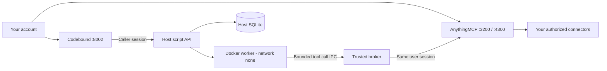

# Codebound

Clone this repository to run your own AnythingMCP and Codebound host. Create your own administrator, invite users, configure connectors and run saved Python scripts in restricted Docker workers. Host mode does not install the hackathon kit or create Alice, Bob or Carol.

## Start your own host

Install Python 3.11+ and Docker with its Linux engine and Compose v2. Git is needed to clone the repository. Start Docker before launching. Windows, Linux and macOS use the same Python entry point; only Windows has been exercised end to end so far. Published AnythingMCP uses amd64; Docker Desktop can emulate it on ARM.

```sh
git clone --depth 1 --branch dev_sanchit https://github.com/Kunaalkk1/BFH_Codebound.git
cd BFH_Codebound
python launch.py
```

Use `python3` if that is your system's Python 3.11+ command. First launch creates the Python environment, installs missing backend dependencies, generates private host secrets, starts the database and pinned AnythingMCP image, builds the restricted worker and starts Codebound. Internet access is needed for initial downloads. No Node installation, official kit, model download or Claude configuration is required for host startup.

1. Open **http://localhost:3200/login** and create an account with your own name, email and password. The first account becomes administrator. The launcher does not create an administrator.
2. Configure your connectors and MCP servers in AnythingMCP. Administrators invite additional users through user management. With no SMTP, share the invitation link manually.
3. Open **http://127.0.0.1:8002**, sign in with the same account, select your MCP server and inspect its available tools.
4. Save a script, specify its allowed tool names and run it with JSON parameters. An empty binding list permits pure Python processing. Load a saved script to review or edit its source.

AnythingMCP may show email verification and edition setup during first sign-in. Its self-hosted flow offers **Skip for now** when email is unavailable. Choose the edition appropriate to your use; this repository preserves upstream licensing behavior.

First signup is enabled on an empty database. Subsequent signup is invitation-only by default. To deliberately enable additional self-registration, set `ALLOW_OPEN_REGISTRATION=true` in your private `.local/host/compose.env` and relaunch. Host mode never imports demo accounts or credentials.

```sh
python launch.py --status
python launch.py --stop
python launch.py --dependencies-only
python launch.py --test
```

Launch reuses healthy services. Stop preserves accounts, credentials, scripts and volumes. Worker source changes trigger a rebuild on the next launch. Existing secrets are never replaced; if a host volume exists but its configuration is missing, startup refuses and asks you to restore it. Windows wrappers `setup.ps1` and `launch.ps1` also default to host mode.

## Your data and identity

| Host component | Address / storage |
|---|---|
| AnythingMCP dashboard | http://localhost:3200 |
| AnythingMCP API / MCP | http://127.0.0.1:4300 |
| Codebound UI / API reference | http://127.0.0.1:8002 and `/docs` |
| Users and connectors | `codebound-host_host_postgres_data` Docker volume |
| Host secrets and pinned image | `.local/host/compose.env` |
| Host scripts and execution audit | `.local/host/codebound.sqlite3` |
| Managed API logs | `.local/host/backend.out.log`, `.local/host/backend.err.log` |

Back up the database volume, host SQLite database and `compose.env` together. Losing `ENCRYPTION_KEY` prevents decryption of stored connector credentials. `.local`, virtual environments, downloaded repositories and generated results are ignored by Git. Each host generates its own secrets. Kit/demo installations and their volumes remain separate.

Codebound validates the caller's live AnythingMCP session on each authenticated request. Scripts belong to the real user ID and organization ID. The broker forwards that same session to the selected MCP server and intersects saved tool bindings with the tools visible to that user. AnythingMCP authorizes each actual tool call. Administrators and editors can create scripts; users can access their own scripts only. Session revocation and permission changes apply on subsequent requests.



## Scripts and optional generation

The worker provides `parameters` and `tools.call(name, arguments)`. Print one compact JSON object. Standard-library Python is available; submitted source executes inside the Docker worker.

```python
import json
print(json.dumps({"total": sum(parameters["amounts"])}))
```

For connector calls, select your MCP server and include the exact discovered tool name in the script's allowed bindings:

```python
import json
response = tools.call("your_inventory_tool", {})
print(json.dumps({"result": response}))
```

Local Ollama generation is optional. Install/start native Ollama, pull a model such as `qwen2.5-coder:3b`, set `OLLAMA_MODEL` before launching (or store `{"model":"qwen2.5-coder:3b"}` in `.local/ollama.json`) and use the generation form. Stop and relaunch the API to pick up changed environment settings. Generation uses authorized tool schemas and saves source for review; it does not execute the generated program automatically. Generated programs can fail and should be reviewed. There is no cloud model fallback.

API clients sign in with `POST /session/login` and use the returned bearer session for `/v1/me`, `/v1/servers`, `/v1/tools/{server_id}`, `/v1/scripts` and `/v1/generate`. Scripts support retrieval, version-checked updates, deletion and `/v1/scripts/{id}/execute`. See `/docs` for schemas. Current host integration is the browser UI and authenticated HTTP API; the existing Claude bridge is specific to demo mode.

## Explicit hackathon demo

The official Codebound Kit is a separate environment with synthetic Alice/Bob/Carol users, mock services, reference workflows and benchmark fixtures. Only explicit demo setup creates those identities. Its Windows launcher, dependency fetching, Claude bridge and acceptance instructions are in [the demo guide](docs/hackathon-demo.md).

```sh
python launch.py demo --setup
python launch.py demo
python launch.py demo --status
python launch.py demo --benchmark
python launch.py demo --stop
```

Windows equivalents are `setup.ps1 -Demo` and `launch.ps1 -Demo`. Demo uses ports 3100/4200/8001 and its own mock services and databases. Host uses 3200/4300/8002; both can coexist. Host mode has no dependency on fixture data, demo keys or DPAPI snapshots. The full official checker still reports optional Level 3 as unsupported.

## Verification and deployment scope

The default test suite covers authentication, script ownership, workspace isolation, version conflicts, sandbox policy and existing demo logic. Live tests are opt-in: `CODEBOUND_TEST_HOST=1` runs `tests/test_host_live.py` against an empty disposable gateway on port 4300 and real Docker. Those tests deliberately create accounts and refuse a populated instance; do not enable them against a working host. Ordinary tests do not create users.

Workers retain a read-only root, no host mounts or credentials, network `none`, an unprivileged user, dropped capabilities, no-new-privileges, seccomp and CPU/memory/PID limits. Brokered execution allows at most 64 calls, 2 MiB input, 16 KiB output and two concurrent runs per organization. The worker deadline is 15 seconds. Credentials and network access remain in the trusted host process.

The supplied host binds to loopback for use on each person's own machine. It does not configure public hosting, TLS, SMTP, firewall rules or remote browser origins. A shared network deployment needs those settings, backups and an appropriate reverse proxy; changing a bind address alone is insufficient. Docker workers share the host kernel, and Docker daemon access remains privileged infrastructure authority.
